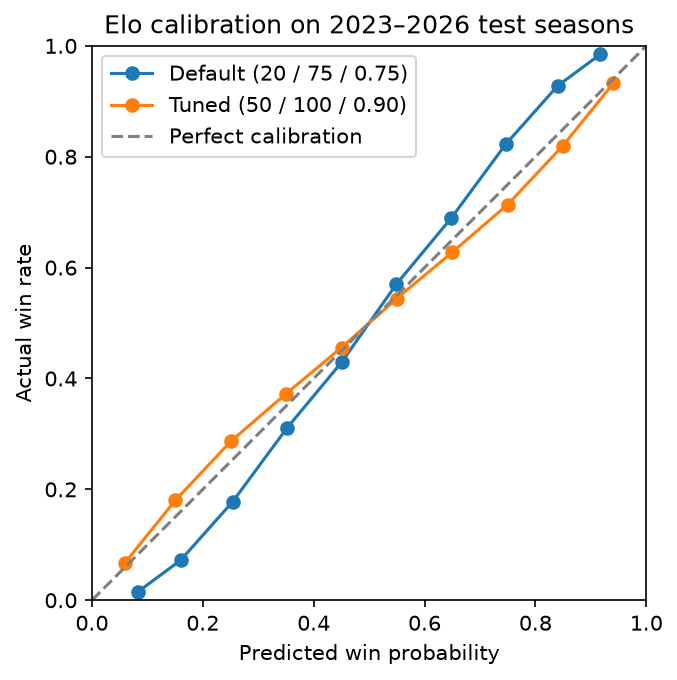

# CBB Predictor


A machine learning model that predicts the outcome of men's NCAA Division I basketball games, giving a win probability and a projected point margin for every matchup. It is trained on 20+ seasons of historical box scores and evaluated against Vegas closing lines.

> **Status:** 🏀 Making live Elo predictions for the 2026–27 season, with more models in development. See the [Roadmap](#roadmap) for progress.

---

## Why this project

College basketball is one of the hardest sports to predict. There are 360+ Division I teams, huge gaps in talent, short seasons, and rosters that turn over every year because of the transfer portal. This project explores how far a carefully built, leakage-free model can get, and whether it can approach the accuracy of the betting market.

## Approach

1. **Point-in-time features.** Every feature is computed using only information available *before tipoff*. Training on season-final stats is the most common mistake in sports modeling, and it produces backtests that look great but don't hold up on real games.
2. **Tempo-free statistics.** Teams are compared on per-possession efficiency rather than raw points, so a fast-paced team isn't confused with a good one.
3. **Baseline first.** An Elo rating system and a logistic regression set the bar. Gradient-boosted trees (LightGBM) only earn their place if they beat it.
4. **Time-based validation.** The model is trained on past seasons and tested on later ones, walking forward one season at a time. It never uses random splits.
5. **Benchmarked against the market.** Vegas closing lines are the toughest public benchmark there is.

### Features (planned)

| Category | Examples |
|---|---|
| Efficiency | Adjusted offensive/defensive efficiency (points per 100 possessions), tempo |
| Four Factors | eFG%, turnover rate, offensive rebound rate, free-throw rate (offense and defense) |
| Ratings | Elo rating and rating difference |
| Context | Home/away/neutral site, rest days, travel distance |
| Form | Rolling performance over recent games |
| Priors | Previous-season ratings regressed toward the mean (key for early-season games) |

### Evaluation metrics

- **Log loss** and **Brier score**: how well-calibrated the win probabilities are
- **Mean absolute error**: accuracy of the predicted point margin
- **Straight-up accuracy** and **accuracy against the spread**

## Results

### Elo baseline

The first model is an Elo rating system built from game results and locations alone. Its settings (K-factor, home advantage, and how much of each rating carries over between seasons) were tuned on the 2004–2022 seasons, then scored once on the **held-out 2023–2026 seasons** (22,698 games):

| Model | Accuracy | Log loss | Brier score |
|---|---|---|---|
| Coin flip | 50.0% | 0.693 | 0.250 |
| Elo, default settings (K=20, home=75, carryover=0.75) | 70.4% | 0.572 | 0.195 |
| **Elo, tuned (K=50, home=100, carryover=0.90)** | **70.8%** | **0.557** | **0.190** |

Lower is better for log loss and Brier score.

**Key findings:**

- **The default Elo was underconfident.** When it gave a team a 75% chance, that team actually won about 84% of the time. Its ratings moved too slowly to separate the best teams from the weakest. Raising K fixed most of this, and the tuned model's probabilities sit close to the ideal calibration line.
- **The held-out score is the honest one.** Tuned Elo scored 0.536 log loss on the seasons it was tuned on but 0.557 on the unseen seasons. Reporting the tuning score would have overstated the model.
- **2021 was the hardest season to predict** (69.0% accuracy for tuned Elo), likely because COVID shortened schedules and largely removed crowds. That season also had the lowest home win rate in the data (61.4%).
- **The ratings pass a sanity check.** At the end of 2025, the top four teams by tuned Elo were Houston, Florida, Duke, and Auburn: the actual Final Four.



Full analysis: [`notebooks/03_elo_baseline.ipynb`](notebooks/03_elo_baseline.ipynb). This is the baseline every later model must beat.

### Live 2026–27 season

The tuned Elo model makes a prediction for every scheduled game before tip-off, then grades each prediction once the game is final. Only predictions logged **before** a game started are scored.

| Period | Games | Accuracy | Log loss | Brier score |
|---|---|---|---|---|
| Opening night (Nov 2, 2026) | 114 | 89.5% | 0.362 | 0.109 |

Opening week is full of mismatches between power-conference teams and small schools, so these early numbers are much better than the model's true level. The 70.8% held-out result above is the realistic expectation for a full season.

## Daily pipeline

One command, `cbb-update`, runs the whole day's work in order and stops at the first error, so a later step never runs on stale data:

| Step | Command | What it does |
|---|---|---|
| 1 | `cbb-fetch` | Downloads the season's schedule and results from the CollegeBasketballData API |
| 2 | `cbb-teams` | Maps CBBD team IDs onto the Kaggle team IDs used in the historical data |
| 3 | `cbb-live` | Reshapes the games into one row per team per game, with Eastern dates and tip-off times |
| 4 | `cbb-score` | Grades the latest pre-game prediction for every finished game and lists the night's biggest upsets |
| 5 | `cbb-predict` | Updates Elo with every finished game, predicts all scheduled games and appends them to a prediction log |
| 6 | `cbb-report` | Writes an HTML page of the next game day's predictions to `reports/` and opens it in the browser |

Predictions are **appended** to a log table rather than overwritten, so every game can be scored against what the model said before it tipped off.

## Tech stack

| Layer | Tools |
|---|---|
| Language and environment | Python 3.13, [uv](https://docs.astral.sh/uv/) |
| Storage | DuckDB, Parquet |
| Data wrangling | pandas |
| Modeling | scikit-learn, LightGBM |
| Dashboard | Streamlit |
| Testing | pytest |

## Data sources

- **[Kaggle: March Machine Learning Mania](https://www.kaggle.com/competitions)**: historical men's D1 results and detailed box scores (2003–present)
- **[CollegeBasketballData.com](https://collegebasketballdata.com)**: current-season games and box scores
- **[The Odds API](https://the-odds-api.com)**: betting lines used for benchmarking

Raw data is **not** included in this repository. See [Getting started](#getting-started) for how to download it.

## Project structure

```
cbb-predictor/
├── data/
│   ├── raw/              # Downloaded source data (git-ignored)
│   └── processed/        # Cleaned Parquet files and DuckDB database (git-ignored)
├── notebooks/            # Exploratory analysis
├── reports/              # Generated daily HTML reports (git-ignored)
├── src/cbb_predictor/
│   ├── ingest/           # Kaggle and CBBD data download, team mapping, reshaping
│   ├── features/         # Elo ratings, predictions, scoring, HTML reports
│   ├── models/           # Training and backtesting (planned)
│   ├── app/              # Streamlit dashboard (planned)
│   └── update.py         # cbb-update: the daily pipeline
├── tests/
├── pyproject.toml
└── uv.lock
```

## Getting started

**Prerequisites:** [uv](https://docs.astral.sh/uv/getting-started/installation/), a free [Kaggle](https://www.kaggle.com) account, and a free [CollegeBasketballData](https://collegebasketballdata.com) API key for live predictions.

```bash
# Clone the repository
git clone https://github.com/coreyw7/cbb-predictor.git
cd cbb-predictor

# Install Python and all dependencies (creates .venv automatically)
uv sync
```

**Download the data:** Get the latest March Machine Learning Mania dataset from Kaggle and place the men's files (prefixed with `M`) in `data/raw/`.

**Build the database:** Load raw data into DuckDB, then compute the features such as Elo ratings.

```bash
uv run cbb-ingest
uv run cbb-features
```

**Add your API key:** create a `.env` file in the project root (it is git-ignored):

```
CBBD_API_KEY=your-key-here
```

**Run the daily pipeline:** fetch the latest games, score last night, predict upcoming games and open the report.

```bash
uv run cbb-update
```

Each step can also be run on its own, for example `uv run cbb-score` or `uv run cbb-report`.

**Schedule it (optional):** run `cbb-update` automatically every morning. 9 AM local time works well:
last night's games are final, and no games have tipped off yet. Create a `logs/` folder first
(`mkdir logs`), since the schedulers below write their output there.

<details>
<summary><b>macOS (launchd)</b></summary>

Edit the paths in [`deploy/com.coreyw7.cbb-update.plist`](deploy/com.coreyw7.cbb-update.plist) to match
your machine (`which uv` gives the path to uv), then:

```bash
ln -s "$PWD/deploy/com.coreyw7.cbb-update.plist" ~/Library/LaunchAgents/
launchctl bootstrap gui/$(id -u) ~/Library/LaunchAgents/com.coreyw7.cbb-update.plist
launchctl kickstart gui/$(id -u)/com.coreyw7.cbb-update   # run once now to test
```

If the Mac is asleep at 9 AM, launchd runs the job when it wakes.
</details>

<details>
<summary><b>Windows (Task Scheduler)</b></summary>

In Command Prompt, replacing the path with your project folder:

```
schtasks /Create /SC DAILY /ST 09:00 /TN "cbb-update" /TR "cmd /c cd /d C:\path\to\cbb-predictor && uv run cbb-update >> logs\update.log 2>&1"
```

To catch up after the PC was asleep, open Task Scheduler → `cbb-update` → Properties → Settings and check
**Run task as soon as possible after a scheduled start is missed**.
</details>

<details>
<summary><b>Linux (cron)</b></summary>

Add this line with `crontab -e`, using the full path from `which uv`:

```
0 9 * * * cd ~/cbb-predictor && ~/.local/bin/uv run cbb-update >> logs/update.log 2>&1
```

cron skips runs missed while the machine is off. Use a systemd timer with `Persistent=true` if you need catch-up.
</details>

Output from each run is appended to `logs/update.log`.

**Run the tests:**

```bash
uv run pytest
```

## Roadmap

- [x] Project setup (uv, git, project structure)
- [x] Load historical Kaggle data into DuckDB
- [x] Team ID mapping across data sources
- [x] Elo rating system
- [x] Live in-season pipeline: fetch, score, predict and HTML report (`cbb-update`)
- [x] Scheduled daily runs
- [ ] Point-in-time feature pipeline
- [ ] Baseline logistic regression and backtest
- [ ] LightGBM model with full feature set
- [ ] Benchmark against Vegas closing lines
- [ ] Streamlit dashboard

## Disclaimer

This is a personal learning and portfolio project. Predictions are for educational purposes only and are not betting advice.
