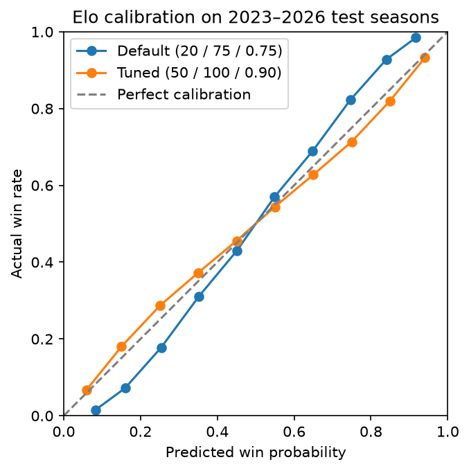

# CBB Predictor

A machine learning model that predicts the outcome of men's NCAA Division I basketball games, giving a win probability and a projected point margin for every matchup. It is trained on 20+ seasons of historical box scores and evaluated against Vegas closing lines.

> **Status:** 🚧 In active development for the 2026–27 season. See the [Roadmap](#roadmap) for progress.

---

## Why this project

College basketball is one of the hardest sports to predict. There are 360+ Division I teams, huge gaps in talent, short seasons, and rosters that turn over every year because of the transfer portal. This project explores how far a carefully built, leakage-free model can get, and whether it can approach the accuracy of the betting market.

## Approach

1. **Point-in-time features.** Every feature is computed using only information available *before tipoff*. Training on season-final stats is the most common mistake in sports modeling, and it produces backtests that look great but don't hold up on real games.
2. **Tempo-free statistics.** Teams are compared on per-possession efficiency rather than raw points, so a fast-paced team isn't confused with a good one.
3. **Baseline first.** An Elo rating system and a logistic regression set the bar. Gradient-boosted trees (LightGBM) only earn their place if they beat it.
4. **Time-based validation.** The model is trained on past seasons and tested on later ones, walking forward one season at a time. It never uses random splits.
5. **Benchmarked against the market.** Vegas closing lines are the toughest public benchmark there is.

### Features (planned)

| Category | Examples |
|---|---|
| Efficiency | Adjusted offensive/defensive efficiency (points per 100 possessions), tempo |
| Four Factors | eFG%, turnover rate, offensive rebound rate, free-throw rate (offense and defense) |
| Ratings | Elo rating and rating difference |
| Context | Home/away/neutral site, rest days, travel distance |
| Form | Rolling performance over recent games |
| Priors | Previous-season ratings regressed toward the mean (key for early-season games) |

### Evaluation metrics

- **Log loss** and **Brier score**: how well-calibrated the win probabilities are
- **Mean absolute error**: accuracy of the predicted point margin
- **Straight-up accuracy** and **accuracy against the spread**

## Results

### Elo baseline

The first model is an Elo rating system built from game results and locations alone. Its settings (K-factor, home advantage, and how much of each rating carries over between seasons) were tuned on the 2004–2022 seasons, then scored once on the **held-out 2023–2026 seasons** (22,698 games):

| Model | Accuracy | Log loss | Brier score |
|---|---|---|---|
| Coin flip | 50.0% | 0.693 | 0.250 |
| Elo, default settings (K=20, home=75, carryover=0.75) | 70.4% | 0.572 | 0.195 |
| **Elo, tuned (K=50, home=100, carryover=0.90)** | **70.8%** | **0.557** | **0.190** |

Lower is better for log loss and Brier score.

**Key findings:**

- **The default Elo was underconfident.** When it gave a team a 75% chance, that team actually won about 84% of the time. Its ratings moved too slowly to separate the best teams from the weakest. Raising K fixed most of this, and the tuned model's probabilities sit close to the ideal calibration line.
- **The held-out score is the honest one.** Tuned Elo scored 0.536 log loss on the seasons it was tuned on but 0.557 on the unseen seasons. Reporting the tuning score would have overstated the model.
- **2021 was the hardest season to predict** (69.0% accuracy for tuned Elo), likely because COVID shortened schedules and largely removed crowds. That season also had the lowest home win rate in the data (61.4%).
- **The ratings pass a sanity check.** At the end of 2025, the top four teams by tuned Elo were Houston, Florida, Duke, and Auburn: the actual Final Four.



Full analysis: [`notebooks/03_elo_baseline.ipynb`](notebooks/03_elo_baseline.ipynb). This is the baseline every later model must beat.

## Tech stack

| Layer | Tools |
|---|---|
| Language and environment | Python 3.13, [uv](https://docs.astral.sh/uv/) |
| Storage | DuckDB, Parquet |
| Data wrangling | pandas |
| Modeling | scikit-learn, LightGBM |
| Dashboard | Streamlit |
| Testing | pytest |

## Data sources

- **[Kaggle: March Machine Learning Mania](https://www.kaggle.com/competitions)**: historical men's D1 results and detailed box scores (2003–present)
- **[CollegeBasketballData.com](https://collegebasketballdata.com)**: current-season games and box scores
- **[The Odds API](https://the-odds-api.com)**: betting lines used for benchmarking

Raw data is **not** included in this repository. See [Getting started](#getting-started) for how to download it.

## Project structure

```
cbb-predictor/
├── data/
│   ├── raw/              # Downloaded source data (git-ignored)
│   └── processed/        # Cleaned Parquet files and DuckDB database (git-ignored)
├── notebooks/            # Exploratory analysis
├── src/cbb_predictor/
│   ├── ingest/           # Data download and loading
│   ├── features/         # Point-in-time feature engineering, Elo ratings
│   ├── models/           # Training, backtesting, prediction
│   └── app/              # Streamlit dashboard
├── tests/
├── pyproject.toml
└── uv.lock
```

## Getting started

**Prerequisites:** [uv](https://docs.astral.sh/uv/getting-started/installation/) and a free [Kaggle](https://www.kaggle.com) account.

```bash
# Clone the repository
git clone https://github.com/coreyw7/cbb-predictor.git
cd cbb-predictor

# Install Python and all dependencies (creates .venv automatically)
uv sync
```

**Download the data:** Get the latest March Machine Learning Mania dataset from Kaggle and place the men's files (prefixed with `M`) in `data/raw/`.

**Build the database:** Load raw data into DuckDB, then compute the features such as Elo ratings.

```bash
uv run cbb-ingest
uv run cbb-features
```

**Run the tests:**

```bash
uv run pytest
```

## Roadmap

- [x] Project setup (uv, git, project structure)
- [x] Load historical Kaggle data into DuckDB
- [ ] Team ID mapping across data sources
- [ ] Point-in-time feature pipeline
- [x] Elo rating system
- [ ] Baseline logistic regression and backtest
- [ ] LightGBM model with full feature set
- [ ] Benchmark against Vegas closing lines
- [ ] Nightly pipeline for live in-season predictions
- [ ] Streamlit dashboard

## Disclaimer

This is a personal learning and portfolio project. Predictions are for educational purposes only and are not betting advice.
